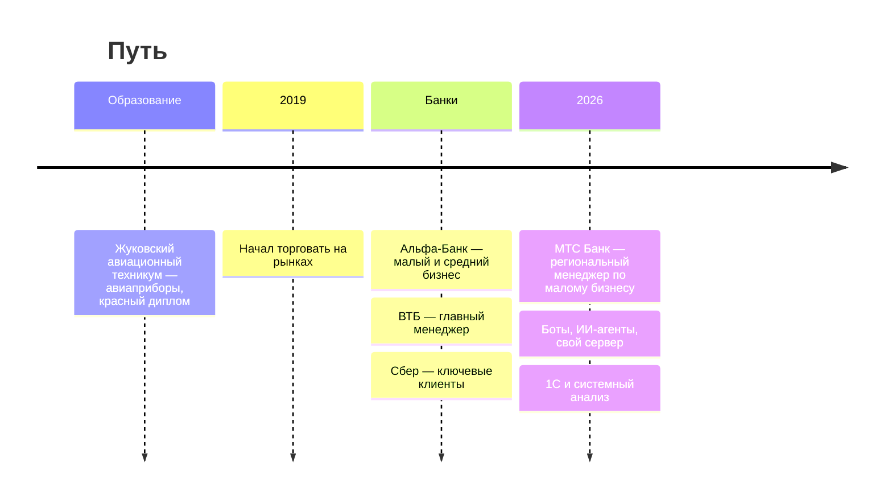

<h1 align="center">Сергей Черёмухин</h1>

  <b>Автоматизация · ИИ-агенты · боты · серверы</b> 
  Из банковских продаж — в разработку систем, которые работают сами

  
  
  
  
  
  

---

## Кто я

Строю рабочие системы вместе с ИИ-агентами: ставлю задачу, проверяю тестами, довожу до запуска и поддерживаю. До этого — годы в банках на продажах малому бизнесу, поэтому думаю от клиента и результата. Свои разработки держу закрытыми, в публичном профиле — только то, чем занимаюсь.

## Чем занимаюсь

| Направление | Что делаю |
|---|---|
| 🤖 **Боты и автоматизация** | Команда ботов на каждый день: напоминания о сроках, вечерние итоги, раздача задач исполнителям. Всё управляется с телефона |
| 💬 **Телеграм-мост** | Свой мост между Telegram и ИИ-агентами: голосовые и фото на входе, кнопки «Да/Нет», расшифровка речи на своём компьютере |
| 🧠 **ИИ-агенты** | Claude Code и мультиагентные схемы: один агент решает, кто делает задачу, другие исполняют. Голосовой агент, который сам звонит — только после моего «да» |
| 🛡 **Серверы и VPN** | Свой сервер: сертификаты, мониторинг с оповещением в Telegram, ежедневные копии, Docker |
| 🗂 **1С** | Учу 1С и системный анализ: путь от бухгалтерии до аналитика, план на ~40 недель |
| 🏦 **МТС Банк** | Региональный менеджер по привлечению малого бизнеса (с сентября 2026) — продукты для МСБ, РКО, ВЭД |
| 📈 **Крипто-аналитика** | На рынках с 2019. Свои инструменты на открытых данных: цены, funding, открытый интерес, опционы; сценарии и ликвидации в DeFi (Foundry, Solidity) — на тестовых копиях сети |

## Опыт

## Стек

**Языки и среды:** Python · Node.js · Solidity · Bash/PowerShell  
**Инфраструктура:** Linux-сервер · Docker · WSL · Nginx/сертификаты · Foundry  
**ИИ и голос:** Claude Code · whisper.cpp · синтез речи · Telegram Bot API  
**Учу сейчас:** 1С · системный анализ

## Принципы

- Сначала тест, потом деньги: рискованное гоняю на копии.
- Секреты не в коде.
- Данные против моей идеи — значит, идея плохая.
